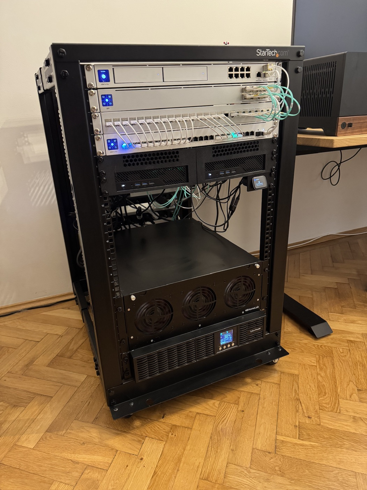
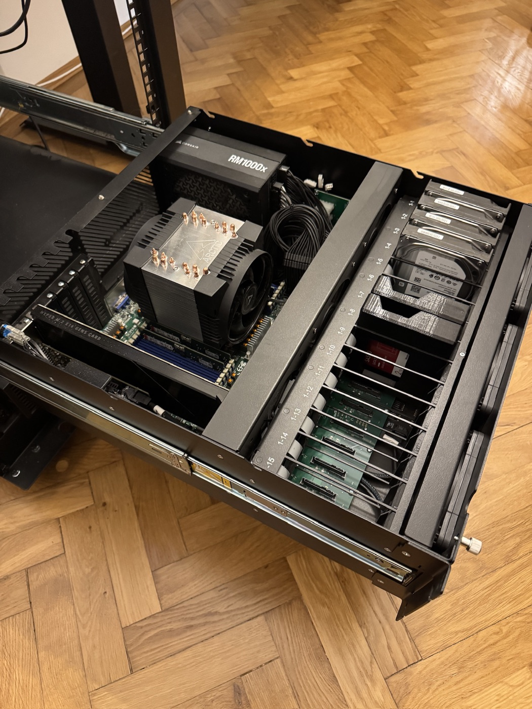
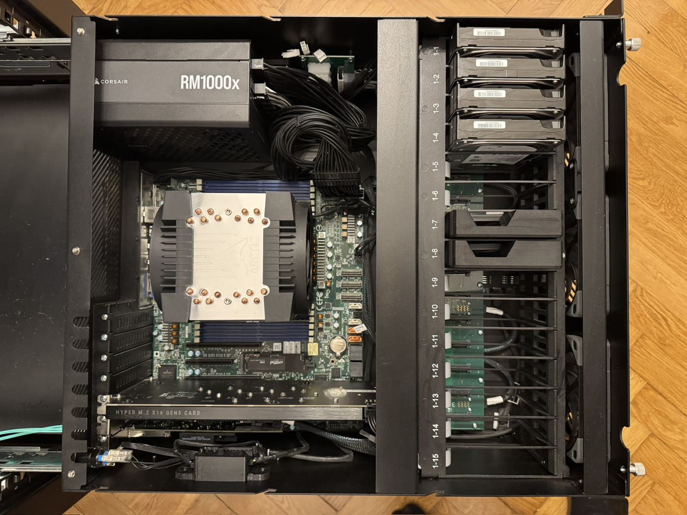
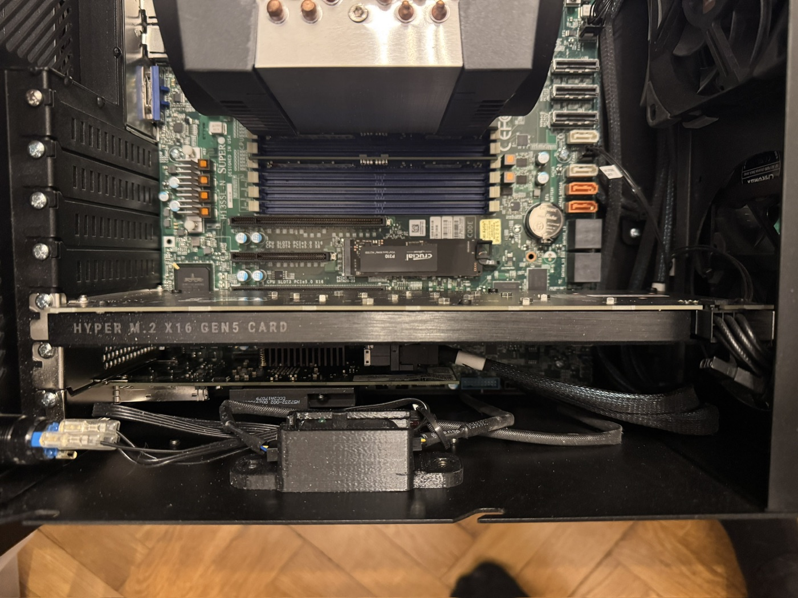

# homelab

  

Infrastructure for my home Kubernetes cluster: three nodes running [Talos Linux](https://www.talos.dev/), with all
persistent data living on TrueNAS. Everything is declared in this repository:

| Directory     | What it manages                                   | Applied with                     |
|---------------|---------------------------------------------------|----------------------------------|
| `tofu/`       | Talos machine configs, Proxmox containers, cloud buckets | `tofu/scripts/tofu.sh apply`     |
| `helm/`       | Cluster add-ons and apps from Helm charts         | `helm/scripts/helmfile.sh apply` |
| `kubernetes/` | Plain manifests for everything without a chart    | `kubectl apply -f <dir>`         |
| `docker/`     | Images built on top of upstream ones              | `docker buildx build --push`     |

## Nodes

- **Talos Linux** on three nodes: a control plane (which also schedules regular workloads) running as a VM on the
  Proxmox host, and two bare-metal workers. Machine configs are generated and applied by OpenTofu with the
  [siderolabs/talos](https://registry.terraform.io/providers/siderolabs/talos) provider, using an Image Factory
  schematic for system extensions such as `iscsi-tools`.
- **Proxmox** runs the Talos control plane and TrueNAS as VMs, plus small supporting services as LXC containers:
  currently a [NUT](https://networkupstools.org/) server that reads the UPS over SNMP and tells the nodes when to
  shut down.

### Hardware

| Machine             | Runs                          | CPU                                       | Memory     | Network                                   |
|---------------------|-------------------------------|-------------------------------------------|------------|-------------------------------------------|
| Proxmox host        | Control plane VM, TrueNAS VM  | AMD EPYC 9135 (16 cores, 32 threads)      | 64 GB      | 2× 10 Gbit/s fiber with link aggregation  |
| 2× Minisforum MS-A2 | Workers                       | AMD Ryzen 9 7945HX (16 cores, 32 threads) | 64 GB each | 2× 10 Gbit/s fiber, one per VLAN          |

The network is split into two VLANs: an internal **servers** VLAN and an **external** VLAN for access from the
internet. Each worker has two 10 Gbit/s fiber uplinks to a UniFi Switch Aggregation (USW Aggregation), one on each
VLAN, so internet-facing services only ever reach the cluster through the workers. The control plane and TrueNAS
are only on the servers VLAN; the Proxmox host bonds its two 10 Gbit/s fiber uplinks with link aggregation.

<table>
  <tr>
    <td align="center"></td>
    <td align="center"></td>
    <td align="center"></td>
  </tr>
  <tr>
    <td align="center">The Proxmox host slides out on rails</td>
    <td align="center">Inside: EPYC 9135, power supply and the four <code>rotato</code> HDDs</td>
    <td align="center">Hyper M.2 x16 Gen5 card with the four <code>sonic</code> NVMe drives</td>
  </tr>
</table>

## Storage

The nodes themselves are disposable: every persistent volume lives on **TrueNAS**. The
[democratic-csi](https://github.com/democratic-csi/democratic-csi) driver talks to the TrueNAS API and creates a ZFS
dataset or zvol for each PersistentVolumeClaim, then attaches it to the node that needs it.

TrueNAS runs as a VM on the Proxmox host, and its two ZFS pools are built from the drives in that host:

| Pool     | Data drives      | Layout                      | Support drives                                    |
|----------|------------------|-----------------------------|---------------------------------------------------|
| `sonic`  | 4× 2 TB NVMe SSD | RAIDZ1                      | –                                                 |
| `rotato` | 4× 4 TB HDD      | 2 mirrors of 2 drives each  | 2 TB SSD as log (SLOG), 2 TB SSD as cache (L2ARC) |

Each storage class keeps its volumes under `<pool>/k8s/<protocol>/v` and detached snapshots under
`<pool>/k8s/<protocol>/s`.

| StorageClass | Protocol | ZFS pool          | Used for                                          |
|--------------|----------|-------------------|---------------------------------------------------|
| `iscsi-nvme` | iSCSI    | `sonic` (NVMe)    | Databases, app config, anything latency-sensitive |
| `iscsi-hdd`  | iSCSI    | `rotato` (HDD)    | Large single-writer volumes                       |
| `nfs-hdd`    | NFS      | `rotato` (HDD)    | Bulk data shared between pods (`ReadWriteMany`)   |

All classes use `reclaimPolicy: Retain`, so deleting a claim never deletes the data on TrueNAS. The
[snapshot-controller](https://github.com/democratic-csi/charts/tree/master/stable/snapshot-controller) enables CSI
volume snapshots, which back the ZFS-native snapshots velero takes.

PostgreSQL databases run on [CloudNativePG](https://cloudnative-pg.io/), with their volumes on `iscsi-nvme` like
everything else.

### Backups

- **velero** takes scheduled ZFS snapshots of the volumes on TrueNAS, and uploads the contents of volumes labelled for
  offsite backup (plus the current primary of every CNPG cluster) to Backblaze B2 with kopia, encrypted client side.
- **TrueNAS** syncs its own datasets to a separate B2 bucket. That bucket's key cannot delete files, so a compromised
  NAS can only hide data, and old versions stay recoverable.
- The **OpenTofu state** lives in a versioned, KMS-encrypted S3 bucket created by `tofu/bootstrap.tofu`.

## Networking

- **Cilium** is the CNI and replaces kube-proxy. Its LoadBalancer IPAM hands out addresses from two pools, each
  announced over L2 on its own VLAN: one for internal services and one for services reachable from the internet.
- **Traefik** implements the Gateway API. The main listener only admits private source addresses; anything public
  has to be routed through a separate, deliberately short public listener.
- **cert-manager** issues wildcard certificates from Let's Encrypt with Cloudflare DNS-01 challenges.
- **external-dns** publishes records for internal services to Cloudflare, and **blocky** serves DNS (with ad
  blocking) inside the network.

## Operations

- **Monitoring**: Prometheus and node-exporter, with Grafana dashboards and alerts sent to Telegram.
- **Updates**: [Renovate](https://docs.renovatebot.com/) runs in the cluster against the self-hosted Gitea and opens
  pull requests for charts, images, Talos, Kubernetes and the pinned tool versions in this repository.
- **Images**: a private Docker registry in the cluster holds the images built from `docker/`.
- **Scheduling**: the descheduler rebalances pods across nodes, but never evicts single-replica workloads.

## Secrets

No secrets are committed. Kubernetes Secret manifests contain `SETME` placeholders that are filled in before
applying, and both wrapper scripts load credentials from a gitignored `.env` next to them (see the `.env.example`
files for the expected variables).

## About this mirror

This repository is a public, one-way mirror of the private repository the cluster is actually deployed from. It is
regenerated from that repository's `main` branch, so its history does not match the private one and pull requests
here cannot be merged directly. Before publishing, the following is changed:

- **Domains**: every real domain is replaced with `example.com`, including hostnames, label and annotation keys
  (such as `vlan.example.com/servers`) and the names derived from them (such as the `example-com` gateway listener
  and certificate).
- **Host and user names**: the Proxmox host is called `pve`, contact addresses are `admin@example.com`, the Gitea
  admin user is `admin`, and Minecraft player names are `player1`, `player2`, ...
- **Identifiers**: values that identify accounts, such as chat IDs, are replaced with `SETME`, and account-specific
  bucket name prefixes with zeros.

The overall layout, the cluster configuration and the storage setup are published as they are deployed.
